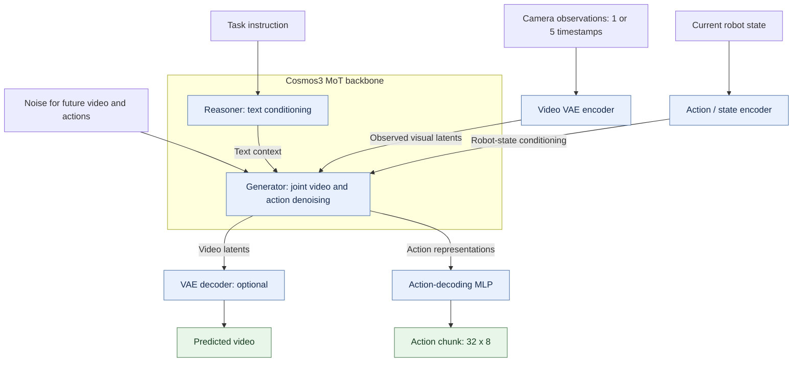
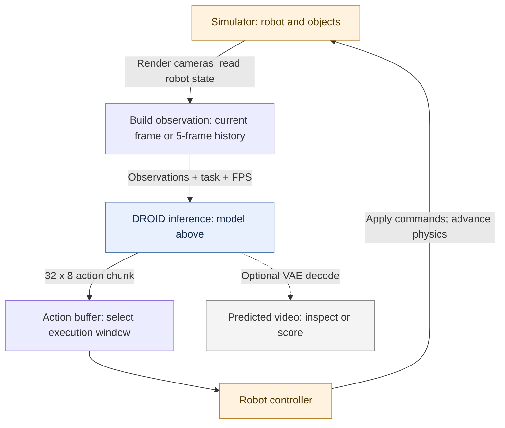

# Model setup

This page explains the models, inputs, and evaluation modes used in our [motion study](README.md). All experiments described here use simulation.

## Models and inputs

We use [Cosmos3-Nano](https://huggingface.co/nvidia/Cosmos3-Nano) (`e59a53c`) for video prediction and [Cosmos3-Nano-Policy-DROID](https://huggingface.co/nvidia/Cosmos3-Nano-Policy-DROID) (`805c0d6`, **DROID** below) for joint video-and-action prediction.

DROID was post-trained on real-robot DROID data from a **mid-trained Nano checkpoint**. It is not necessarily a fine-tune of the released Nano weights we tested ([paper, §4.2.5](https://arxiv.org/html/2606.02800v4#S4.SS2.SSS5)).

| | Base Nano: matched motion test | DROID: official configuration | DROID: our history extension |
|---|---|---|---|
| Visual input | 5 consecutive frames | 1 current frame per camera | 5 consecutive frames per camera |
| Camera layout | Same three-camera composite as DROID | Wrist view above two exterior views | Same layout |
| Observation timing | 15 fps; 0.27 s of history | Current observation | 15 fps; 0.27 s of history |
| Other conditioning | Text prompt and FPS | Task instruction, robot state, and FPS | Same types of conditioning |
| Predicted video | 32 future frames | 32 future frames | 32 future frames |
| Returned actions | None in this test | 32 × 8 values | 32 × 8 values |
| Denoising steps | 35 | 4 | 4, 16, or 35, depending on experiment |

The 32 future frames cover approximately **2.13 s at 15 fps**; our rolling-ball comparison scores the first **1.6 s**. Including the observed prefix, decoded clips contain 33 frames for single-frame conditioning or 37 for five-frame conditioning. The action output is **one chunk of 32 eight-dimensional actions**, nominally covering 2.13 s at 15 Hz.

“Single frame” means one timestamp across three cameras. The five-frame extension supplies temporal history within a request, without retraining; our tested DROID serving path does not retain visual history across requests. FPS is passed explicitly as `conditioning_fps`.

Our earlier Nano demonstration used a different configuration: five 24-fps frames from one 720p camera and a 189-frame output clip. The table describes the later matched-input comparison. Five frames is our selected conditioning length, not a universal requirement for every Nano task.

## Model architecture and data flow

Cosmos3 uses a **Mixture-of-Transformers (MoT)** architecture: an autoregressive transformer handles discrete text tokens, while a diffusion transformer generates continuous modalities. The diagram shows the **DROID generation path** used in our experiments, with preprocessing and sampling details grouped for readability ([architecture](https://huggingface.co/nvidia/Cosmos3-Nano#model-architecture), [policy modules](https://arxiv.org/html/2606.02800v4#S4.SS2.SSS5)).

**Reading the diagram.** The VAE compresses observations across space and time. The generator uses those latents, task text, and robot state to jointly refine the future video and action sequence. The action-decoding MLP maps action features to numeric controls; actions are not extracted from an already decoded video. The diagram groups the repeated generator/sampler updates into one block.

**Time and computation.** FPS supplies temporal-position information. Each denoising step refines the whole future sequence; it is not one action or one video frame. Our standard DROID request uses four steps. Video decoding is an optional output stage: disabling it still leaves video-latent denoising.

**Base Nano comparison.** Our video-only Nano runs use the visual and text pathways, without the robot-state/action branch. This figure focuses on the generation workflow, rather than every modality or visual-reasoning pathway supported by Cosmos3.

## Closed-loop inference and execution

The model above is one component of the robot loop. The simulator supplies real observations for the next request.

The controller executes a configured window of actions before the next observation and inference cycle. The **next input comes from the simulator**, not from the predicted video. In the five-frame variant, the observation builder supplies recent rendered frames; the tested policy does not keep visual memory between requests.

The diagram describes logical data flow, not guaranteed concurrency. Whether physics pauses during inference or continues while actions are pending is an evaluator setting, recorded per experiment.

## How we evaluate

**Offline motion prediction.** We render a rolling ball in MuJoCo, provide observed frames, and compare the predicted continuation with simulator ground truth. No predicted actions are executed. Paired histories end at the same image but approach from opposite directions; repeated-frame inputs provide a stationary control.

**Closed-loop manipulation.** We provide camera observations and robot state, execute a configured portion of the returned action chunk, then observe and infer again. These tests include custom MuJoCo ball grasping and RoboLab banana manipulation in Isaac Sim. Saved predicted videos are diagnostic outputs; the numeric actions drive the robot.

These are separate evaluations: video prediction is scored against a reference continuation, while manipulation is scored from actual simulator execution. Action-chunk execution length and whether simulation advances during inference are specified per experiment.

Detailed configurations: [matched video inputs](https://github.com/jindajia/WAM-Latency-Research/blob/main/reports/4_matched_and_probes/REPORT-A.md) · [grasping setup](https://github.com/jindajia/WAM-Latency-Research/blob/main/reports/8_droid_grasp_pilot/REPORT_droid_grasp_pilot.md). These detailed reports are in a private repository and available on request.
