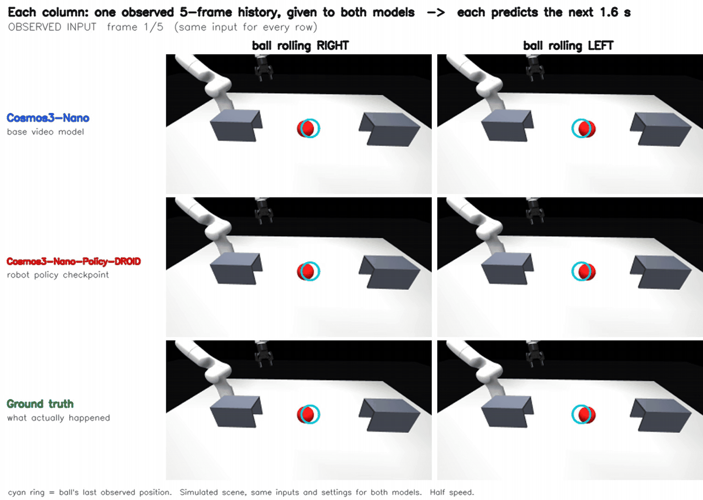
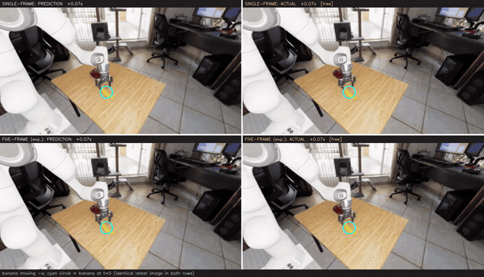

# Motion information, future prediction, and robot actions

We study whether world-action models use observed object motion to predict and act, and how inference latency affects the opportunity to update those actions. All experiments below are small simulation studies.

**Checkpoints used**

- [Cosmos3-Nano](https://huggingface.co/nvidia/Cosmos3-Nano) — general video world model; tested revision `e59a53c`.
- [Cosmos3-Nano-Policy-DROID](https://huggingface.co/nvidia/Cosmos3-Nano-Policy-DROID) — robot policy jointly generating video and actions; tested revision `805c0d6`.

DROID is post-trained on real-robot DROID data from a **mid-trained Cosmos3-Nano checkpoint**, rather than necessarily from the released Nano checkpoint tested here ([training details, §4.2.5](https://arxiv.org/html/2606.02800v4#S4.SS2.SSS5)).

## What we tested and observed

1. **Base Nano followed the rolling ball's motion; DROID did not reliably predict it.**

   With the same five-frame history, base Nano predicted the direction and displacement much more accurately. Separate linear-probe experiments recovered motion information from **both checkpoints**, including their future tokens.

2. **DROID failed to grasp a stationary ball in our MuJoCo scene (0/3).**

   Our hypothesis is that it may predict a stationary target correctly yet still fail to grasp it. *(Correct pre-contact predictions in these same trials remain to be verified.)*

3. **The same DROID checkpoint succeeded on a stationary banana task in Isaac Sim (3/3).**

   We then tested the official RoboLab banana-in-bowl setup and obtained successful manipulation. *(The object, task, and control setup also changed, so this was not a simulator-only comparison.)*

## 1. Experiment details

### Comparing Nano and DROID: generated motion and internal features

Base **Cosmos3-Nano** and the DROID policy receive identical five-frame histories (15 fps, spanning 0.27 s). Over the next 1.6 s, reversing the history direction shifts base Nano's predicted ball displacement by **74–88 px** (ground truth ≈80 px), versus **−9 to +17 px** for DROID across three seeds and two camera views.

*Rows: base Nano, DROID, ground truth; cyan ring: last observed position. Both use 35 denoising steps and guidance 3. Base Nano generates video only; DROID jointly generates video and actions. A separate video-only test of DROID also failed to restore history-following.*

In separate experiments, linear probes on frozen base Nano also recovered ball velocity from both history and future tokens on held-out positions; a repeated-frame control failed. The Nano and DROID probe protocols differed, so their probe scores are not a matched comparison.

For DROID, we froze the checkpoint and trained **linear velocity probes** on its four-step inference features. Each position had five motion histories ending in an identical image; train/test positions were separated. Velocity was readable from both history and future tokens. A representative future-token probe had **0.004 m/s** test error and correctly recovered the sign of an unseen intermediate speed, ±0.30 m/s. Repeating the final frame removed this ability.

These probes read **input motion**, not future-position accuracy. Future tokens carry motion information, but that alone does not establish how the generator uses it. Five-frame conditioning is an experimental extension outside this checkpoint's single-observation fine-tuning setting.

### Static ball grasping in MuJoCo

In our custom **MuJoCo** scene, DROID grasped a stationary ball **0/3** times; a scripted controller using the same action interface succeeded **3/3**. The policy approached the ball but closed too early, too high, or off target.

### Static banana manipulation, then moving-target tests in Isaac Sim

In the official **RoboLab / Isaac Sim** banana-in-bowl task, the same checkpoint succeeded **3/3**. This establishes a working manipulation baseline, not the cause of the earlier failure: object, visuals, physics, and controller settings all changed. DROID policy post-training uses **real-robot data**; Isaac is our evaluation environment.

In a later test requiring advance positioning for a banana moving at 0.05 m/s, single-frame and five-frame inputs both grasped **0/6**. Neither consistently aimed ahead. From that test's own starting pose, static grasping succeeded **2/3** and **3/3**, respectively; a ground-truth anticipatory controller caught the moving banana in both directions.

*Prediction left, execution right; single-frame top, five-frame bottom. The predicted banana stays near its initial position while the actual banana moves away. Click for MP4.*

This small test did not establish a latency-caused failure: simulation paused during inference, and no extra delay was injected.

## 2. Inference cost and when motion information becomes available

We extended the official input to five observed frames without retraining. This enabled history experiments, but did not produce a consistent behavioral improvement.

| Measurement | Single frame (official) | Five frames (experimental) |
|---|---:|---:|
| Warm policy call, actions returned to CPU | **0.80 s** | **1.03 s** |
| VAE encoding | **9.6 ms** | **152 ms** |
| Action output | 32 × 8 | 32 × 8 |

*One H100; four UniPC steps, guidance 3, shift 5; 20 warm calls. Network and video decoding excluded. VAE timings use synchronized stage measurements.*

Denoising accounts for about **92%** of the single-frame request; skipping video decoding still leaves video-latent denoising. In the five-frame probe experiment, motion-bearing transformer features were available at **0.21–0.28 s**, before actions arrived at approximately **1.02 s**. Early availability motivates correction experiments; it does not yet establish an effective correction method.

## Research direction and collaboration

**Can fresh observations and early motion features help correct actions that are still being generated or have not yet been executed?**

I welcome collaboration and access to a robot-arm setup for a small moving-object experiment.

Detailed reports are in a private repository and available on request:
[motion study](https://github.com/jindajia/WAM-Latency-Research/blob/main/REPORT.md) ·
[profiling](https://github.com/jindajia/WAM-Latency-Research/blob/main/PROFILING.md) ·
[grasping](https://github.com/jindajia/WAM-Latency-Research/blob/main/reports/8_droid_grasp_pilot/REPORT_droid_grasp_pilot.md).
